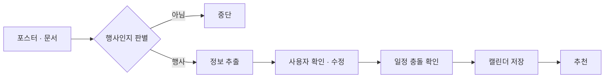
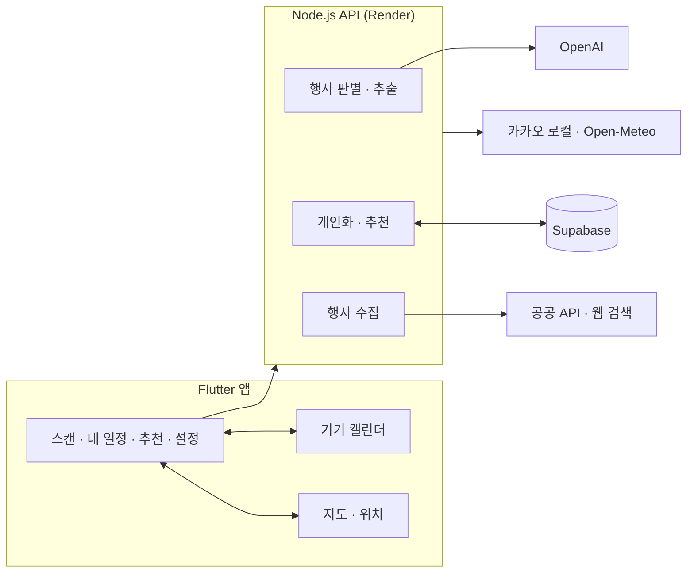

<div align="center">


# Cue

행사 포스터를 찍으면 일정으로 저장해 주는 앱


</div>

<table align="center">
  <tr>
    <td align="center"></td>
    <td align="center"></td>
    <td align="center"></td>
    <td align="center"></td>
  </tr>
  <tr>
    <td align="center"><sub>시작</sub></td>
    <td align="center"><sub>스캔</sub></td>
    <td align="center"><sub>추천</sub></td>
    <td align="center"><sub>관심사 선택</sub></td>
  </tr>
</table>

## 소개

Cue는 행사 포스터나 안내문을 캘린더 일정으로 바꿔 주는 앱입니다. 사진을 찍거나 문서를 고르면 AI가 행사 이름, 날짜, 시간, 장소를 읽고, 사용자가 내용을 확인한 뒤에만 기기 캘린더에 저장합니다. 저장한 일정과 관심 분야를 바탕으로 비어 있는 시간에 갈 만한 행사도 추천합니다.

## 동작 흐름



## 주요 기능

### 입력

- 카메라로 포스터를 찍거나 사진첩에서 고를 수 있습니다.
- PDF, HWP, HWPX 문서도 읽습니다. 한글 문서는 서버에서 본문을 추출해 분석합니다.
- iOS 공유 확장으로 다른 앱에서 Cue로 바로 보낼 수 있습니다.

### 포스터 분석

- 먼저 행사 안내물인지 판단하고, 행사일 때만 세부 정보를 추출합니다.
- 행사 이름, 형식과 주제, 날짜와 시간, 장소, 신청 마감일, 참가비를 읽습니다.
- 같은 장소에서 이어지는 프로그램 시간표는 한 행사로 묶고, 시간이나 장소가 다른 회차는 선택지로 보여 줍니다.
- 한 줄에 함께 적힌 여러 장소는 나눠서 보여 줍니다.
- 포스터에 적혀 있지 않은 날짜와 시간은 채우지 않고 사용자에게 묻습니다.
- 전시처럼 기간 안에 자유롭게 방문하는 행사는 기간과 운영 시간으로 다룹니다.
- 이미 끝난 행사는 분석을 멈추고 알려 줍니다.

### 저장 전 확인

- 추출한 내용을 4단계로 나눠 확인하고 수정합니다.
- 카카오 장소 검색으로 실제 장소를 찾거나 지도에서 직접 고를 수 있습니다.
- "본관 3층"처럼 외부에서 찾기 어려운 장소는 학교나 건물 이름을 함께 적도록 안내합니다.
- 같은 행사를 다시 저장하려고 하면 미리 알려 줍니다.

### 일정 조정

- 기기 캘린더의 기존 일정과 겹치는지 확인하고, 겹치면 같은 날 가까운 빈 시간을 제안합니다.
- 앞뒤 일정 사이의 이동 시간을 계산해 시간이 빠듯하면 알려 줍니다.
- 행사 시간은 자동으로 바꾸지 않고, 옮길지 여부를 사용자가 고릅니다.
- 기간형 행사는 달력에서 방문 날짜를 고르고, 그날 운영 시간과 내 일정을 함께 보며 방문 시간을 정합니다.

### 캘린더와 내 일정

- 저장할 캘린더와 알림 시점을 정해 기기 캘린더에 저장합니다.
- 내 일정 탭에서 저장한 일정을 수정하거나 취소할 수 있고, 변경 내용은 기기 캘린더에도 반영됩니다.

### 지도와 날씨

- 스캔 탭에 다음 일정의 시간, 장소 지도, 그 시각의 날씨를 보여 줍니다.
- 앱 안의 지도에서 하루 일정을 핀으로 확인할 수 있습니다.
- 현재 위치에서 도보와 자동차 경로를 보여 주고, 카카오맵이나 네이버 지도 앱으로 이어서 열 수 있습니다.

### 추천

- 추천 탭을 처음 열면 연령대와 관심 분야를 고릅니다. 생년월일은 받지 않습니다.
- 관심 있음, 관심 없음, 일정 저장과 취소 기록을 바탕으로 관심 분야를 계속 갱신합니다. 오래된 기록일수록 비중이 줄어듭니다.
- 캘린더의 바쁜 시간을 피해 갈 수 있는 행사를 먼저 보여 줍니다. 이때 일정 제목은 보내지 않고 시작과 종료 시간만 사용합니다.
- 내 주변에서 공유된 행사, 비슷한 사용자가 저장한 행사, 관심 분야의 전국 행사로 나눠 보여 줍니다.
- 공연예술통합전산망(KOPIS), 서울 열린데이터광장, 한국관광공사, 서울시립미술관 같은 공식 출처와 웹 검색으로 확인한 행사만 추천합니다.
- 화면을 아래로 당기면 추천을 새로 불러옵니다.

### 설정과 개인정보

- 라이트·다크 테마, 기본 일정 길이, 기본 알림, 사용할 지도 앱을 정할 수 있습니다.
- 개인화 추천을 끄거나 관심사 기록을 초기화할 수 있습니다.
- 사진과 문서는 서버에 저장하지 않습니다. 위치는 대략적인 지역만 사용합니다.
- 익명 계정으로 시작하며, `DELETE /v1/account`로 서버의 사용자 데이터를 삭제할 수 있습니다.

사용자가 찾은 행사를 공유하는 기능과 하루 일정을 노선도처럼 보여 주는 화면은 아직 실험 중입니다.

## 구조



| 영역 | 사용 기술 |
| --- | --- |
| 앱 | Flutter, `device_calendar`, `image_picker`, `file_picker`, `geolocator`, `supabase_flutter`, iOS MapKit, Share Extension |
| 서버 | Node.js 22.13+, OpenAI API (`gpt-4.1-mini`) |
| 데이터 | Supabase PostgreSQL, RLS, 익명 Auth (로컬 테스트는 SQLite) |
| 외부 API | KOPIS, 서울 열린데이터광장, 한국관광공사 TourAPI, 카카오 로컬, Open-Meteo |
| 운영 | Render, GitHub Actions |

```
cue/
├── lib/                  Flutter 앱
├── ios/CueShare/         iOS 공유 확장
├── server/src/           API, 포스터 분석, 개인화, 행사 수집
├── server/test/          서버 테스트
├── supabase/migrations/  테이블, RLS, 트리거
├── test/                 앱 테스트
└── docs/                 소개 페이지
```

OpenAI 키는 서버 프로세스의 `OPENAI_API_KEY` 환경변수에만 둡니다. 앱에는 서버 URL만 전달합니다. `server/setup_key.command`에서 화면에 표시되지 않는 입력으로 키를 받아 권한 `600`의 `server/.env`에 보관하고, 서버 시작 시 환경변수로 읽습니다. 이 파일은 Git에서 제외됩니다.

## 로컬 실행

```bash
cd server
export OPENAI_API_KEY='YOUR_KEY'
export OPENAI_MODEL='gpt-4.1-mini'
npm ci
npm start
```

Mac에서는 `server/setup_key.command`를 더블클릭해 키를 입력할 수도 있습니다. 이 창은 키를 저장한 다음 서버를 `8788` 포트에서 실행합니다. 앱이 Mac의 로컬 서버를 쓰는 동안 창을 열어 두세요.

다른 터미널에서:

```bash
flutter pub get
# iOS 시뮬레이터: 호스트 localhost
flutter run --dart-define=CUE_API_URL=http://localhost:8787
# Android 에뮬레이터: 호스트는 10.0.2.2
flutter run --dart-define=CUE_API_URL=http://10.0.2.2:8787
# iPhone 실기기(release): 배포 서버
flutter run --release -d <iPhone-device-id> \
  --dart-define=CUE_API_URL=https://cue-api-vczh.onrender.com \
  --dart-define=SUPABASE_URL=https://<project>.supabase.co \
  --dart-define=SUPABASE_PUBLISHABLE_KEY=<publishable-key>
```

실기기에서는 배포된 HTTPS 서버 주소를 사용합니다. release 빌드에서 `CUE_API_URL`을 빠뜨리면 배포 서버 주소를 기본값으로 씁니다(디버그 빌드는 `http://localhost:8787`). 개발용 Android 디버그 빌드에서만 일반 HTTP 연결을 허용합니다. Supabase 설정이 없는 로컬 테스트 데이터는 권한 `600`의 `server/data/cue.sqlite`에 저장됩니다. 기존 `cue.json`이 있으면 새 DB의 첫 시작에서 사용자 토큰·저장 일정·추천 목록을 한 번 가져옵니다. 원본 JSON은 백업으로 남고 두 파일 모두 Git에서 제외됩니다.

## 서버 배포 (Render)

저장소 루트의 `render.yaml`은 싱가포르 지역의 무료 Node 웹 서비스를 설정합니다. Render Dashboard에서 GitHub 저장소 `init726/cue`의 Blueprint를 만들고, 생성 화면에서 아래 환경변수를 입력합니다.

| 환경변수 | 필수 | 용도 |
| --- | :---: | --- |
| `OPENAI_API_KEY` | O | 포스터·문서 분석, 웹 검색 |
| `SUPABASE_URL`, `SUPABASE_PUBLISHABLE_KEY`, `SUPABASE_SERVICE_ROLE_KEY` | O | 사용자 인증과 데이터 저장 |
| `KAKAO_REST_API_KEY` | | 행사장을 지도의 실제 장소로 연결. 없으면 입력한 장소 이름을 그대로 씁니다. |
| `KOPIS_API_KEY` | | 공연예술통합전산망 [Open API](https://kopis.or.kr/por/cs/openapi/openApiInfo.do?menuId=MNU_00074) 공연 추천 |
| `SEOUL_OPEN_API_KEY` | | 서울 열린데이터광장 문화행사 |
| `TOUR_API_KEY` | | 공공데이터포털 한국관광공사 국문 관광정보 서비스_GW |
| `CATALOG_ADMIN_TOKEN` | | 행사 수집·등록 관리자 토큰 |

선택 키가 없거나 해당 서비스가 실패해도 분석과 일정 저장은 그대로 동작합니다. 키 값은 Git에 넣지 않습니다. 무료 서비스는 유휴 시 잠들어 첫 요청이 지연될 수 있으므로 앱은 서버 시작을 기다릴 수 있어야 합니다.

배포가 끝나면 `https://<배포된 호스트>/health`가 `{"ok":true}`를 반환하는지 확인합니다. `/health/deep`은 Supabase까지 조회해 `{"ok":true,"database":"ok",...}`를 반환하고, 선택 키 설정 여부(`places`, `seoul`, `tour`)와 배포 커밋(`version`)을 함께 알려 줍니다. `.github/workflows/catalog-refresh.yml`은 매일 저장소 시크릿 `CATALOG_ADMIN_TOKEN`으로 `POST /v1/catalog/refresh`를 호출해 추천 행사 목록을 채웁니다. Supabase 무료 프로젝트는 한동안 요청이 없으면 일시 정지되므로, `.github/workflows/keepalive.yml`이 사흘마다 이 주소를 호출합니다. 서버 주소가 바뀌면 저장소 변수 `CUE_API_URL`을 설정하세요. 앱은 빌드 시 `--dart-define=CUE_API_URL=https://<배포된 호스트>`를 지정하고, 기존 Supabase URL 및 publishable key도 그대로 전달해 다시 설치합니다. `CUE_CLOUD_REQUIRED=1`은 배포 필수 키가 빠진 경우 시작을 막고, 로컬 토큰으로 임시 SQLite 계정이 생성되는 것을 막습니다. SQLite 파일은 호스트 재시작 시 사라질 수 있으므로 사용자 데이터는 Supabase를 사용합니다.

## Supabase 연결

SQL 마이그레이션을 프로젝트 SQL Editor에서 실행하고 익명 로그인을 활성화합니다. `SUPABASE_URL`, `SUPABASE_PUBLISHABLE_KEY`를 서버 환경변수(또는 Git에서 제외된 `server/.env`)와 Flutter `--dart-define`에 지정하면 앱이 Supabase Auth 익명 사용자를 만들고 서버가 JWT를 검증합니다. `profiles` 행은 가입 트리거로 생성됩니다. 행사·목표·상호작용은 사용자의 JWT와 RLS로 저장됩니다. 관심도·Memory·추천 계산 결과는 백엔드가 사용자 ID를 검증한 뒤 서버 전용 `SUPABASE_SERVICE_ROLE_KEY`로 저장합니다. 기존 SQLite 사용자 데이터는 해당 사용자의 첫 클라우드 요청 때 한 번 이전합니다. 공유 행사 목록 등록과 Auth 계정 삭제에도 서버 전용 키가 필요합니다. Flutter에는 공개용 URL·publishable key만 들어가며 비밀 키와 OpenAI 키는 넣지 않습니다. 설정 화면에서 연결 상태와 사용자 ID를 확인할 수 있습니다.

## 사용자 기록과 추천

- 설치별 익명 토큰으로 사용자를 분리합니다. 사용자별 `profiles`, `events`, `event_sessions`, `user_events`, `event_interactions`, `interest_profiles`, `goals`, `tasks`, `agent_memories`, `recommendations` 테이블을 서버 DB에 둡니다.
- `관심 있음`, `관심 없음`, `계획하기`, 일정 저장·취소를 원본 행동으로 기록합니다. 가중치와 90일 감쇠 규칙은 `server/src/personalization.js`에 모았습니다. 반복된 근거가 있을 때만 만료 기한이 있는 Memory를 만듭니다.
- 추천은 실제 등록된 미래 행사 중 관심 분야에 맞고 신청 기한이 지나지 않았으며 Cue에 저장한 일정과 겹치지 않는 후보를 고릅니다. 캘린더 권한이 있으면 앞으로 7일의 바쁜 시간(제목 없이 시작·종료만)을 보내 빈 시간에 맞는 행사를 먼저 보여 줍니다. 사용자가 허용하면 대략적인 활동 지역 좌표로 가까운 행사를 고르며, 정확한 위치는 저장하지 않습니다. 추천 이유와 사용자 반응을 기록합니다.
- 설정에서 개인화를 끄면 새 관심 행동 기록과 추천을 중단하고 계산된 관심도·Memory를 비웁니다. `DELETE /v1/account`는 서버의 사용자 데이터를 삭제합니다. 기기 캘린더 항목은 별도로 관리합니다.

## 추천 행사 등록

추천은 확인 가능한 행사 목록을 기반으로 합니다. 목록이 비어 있으면 앱은 빈 상태를 보여주며, 임의의 행사를 만들어 추천하지 않습니다. Supabase 사용자의 추천이 비었거나 새로고침하면 서버가 가장 관심 있는 분야의 공식 출처에서 행사를 찾아 목록에 더합니다. 관심 분야가 아직 없으면 강연·지역 축제·기술 같은 기본 주제로 찾습니다. 추천이 비어 있을 때는 최대 75초까지 검색을 기다린 뒤 응답하고, 덜 끝난 검색은 다음 새로고침에 반영합니다.

- 전시: 서울시립미술관 공식 페이지를 직접 읽고, OpenAI 웹 검색으로 국립현대미술관·서울문화포털 상세 페이지를 함께 찾습니다. 상설 전시는 다음 3주 안의 날짜에 14:00~16:00 추천 방문 시간을 정합니다.
- 음악·공연: `KOPIS_API_KEY`가 있으면 앞으로 30일 안에 열리는 서울 공연을 가져와 내일 이후 가장 가까운 회차를 일정으로 씁니다. 키가 없거나 결과가 없으면 웹 검색을 씁니다.
- 서울 문화행사·전국 축제: `SEOUL_OPEN_API_KEY`, `TOUR_API_KEY`가 있으면 매일 수집 때 공공 API에서 가져옵니다.
- 그 밖의 분야: OpenAI 웹 검색. 검색 출처에 실제로 있는 공식 상세 페이지 URL만 받아들입니다.

관리자가 `CATALOG_ADMIN_TOKEN` 환경변수를 설정한 뒤 실제 행사를 등록할 수도 있습니다.

```bash
curl -X POST http://localhost:8787/v1/catalog/import \
  -H "Authorization: Bearer $CATALOG_ADMIN_TOKEN" \
  -H 'Content-Type: application/json' \
  -d '{"events":[{"title":"행사 이름","venue":"행사 장소","startsAt":"2027-01-01T18:00:00+09:00","endsAt":"2027-01-01T20:00:00+09:00","category":"음악","description":"공식 안내문에서 확인한 설명"}]}'
```

지원 종류는 `server/src/categories.js`(앱은 `lib/cue_categories.dart`)의 세부 카테고리 목록과 같습니다. 일정 저장·관심 표시로 쌓인 관심 분야와 온보딩에서 고른 분야를 기준으로 미래 행사를 추천합니다.

## 데이터와 예외 처리

- 서버는 1차 판정에서 행사 안내물이 아니라고 판단하면 2차 추출 호출을 하지 않습니다.
- 여러 시간·장소 조합은 별도 후보로 전달합니다. 앱에서는 하나를 선택해야 저장할 수 있습니다.
- 추출한 세부 정보가 불명확하면 사용자가 직접 입력해야 합니다. AI가 추출한 정보는 저장 전 수정할 수 있습니다.
- 캘린더 저장에 성공한 뒤에만 서버의 개인 취향 기록을 추가합니다. 사진과 문서는 서버 디스크에 저장하지 않습니다. PDF는 OpenAI에 파일 입력으로 전달하며 HWP/HWPX는 서버에서 본문 텍스트를 추출해 전달합니다. 암호화되거나 글자를 읽을 수 없는 한글 문서는 오류를 표시합니다.
- `내 일정`에서 저장한 일정의 이름·장소·시간·행사 종류·알림을 수정하거나 일정과 알림을 함께 취소할 수 있습니다. 수정·취소는 기기 캘린더와 Cue 기록에 반영됩니다. 이전 버전에서 저장한 일정은 제목·장소·시작/종료 시간이 일치하는 캘린더 항목이 정확히 하나일 때만 연결합니다.
- 현재 로컬 모드에서는 앱 설치별 임의 토큰으로 사용자를 식별합니다. 재설치·기기 변경 시 계정 복원은 제공되지 않습니다. Supabase Auth를 구성하면 익명 계정으로 시작하고 추후 계정 연결을 할 수 있습니다.

## 검사

```bash
flutter analyze
flutter test          # 앱 테스트 30건
cd server && npm test # 서버 테스트 71건
```
